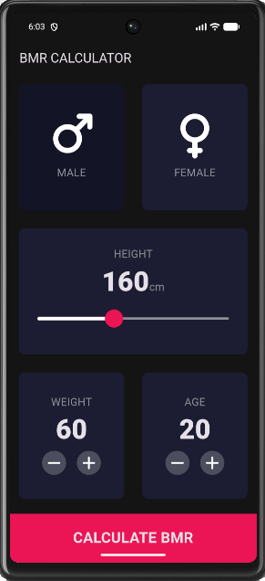
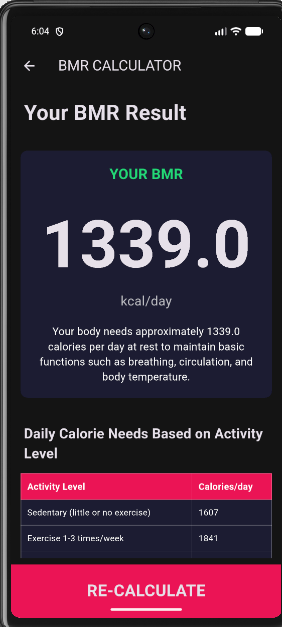
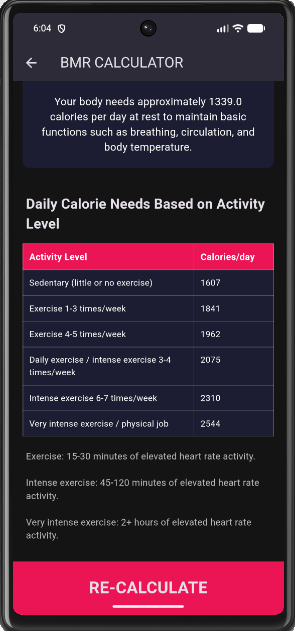

# BMR Calculator

## Anggota Kelompok
1. Aulya Prastika Dewi - K3524047
2. Zukhrufa Na'ilah Rohmah - K3524071
3. Nabila Shafa Salsabila Nurhardriani - K3524081

## Deskripsi Aplikasi
BMR Calculator adalah aplikasi mobile berbasis Flutter
yang digunakan untuk menghitung Basal Metabolic Rate
(BMR), yaitu perkiraan kebutuhan kalori tubuh saat
beristirahat.

Aplikasi ini merupakan pengembangan dari BMI Calculator
menjadi BMR Calculator dengan menggunakan rumus
Mifflin-St Jeor.

## Fitur Aplikasi
- Memilih jenis kelamin (Male/Female).
- Mengatur tinggi badan dalam cm.
- Mengatur berat badan dalam kg.
- Mengatur usia pengguna.
- Menghitung BMR berdasarkan data pengguna.
- Menampilkan estimasi kebutuhan kalori harian
  berdasarkan enam tingkat aktivitas.
- Menghitung ulang melalui tombol RE-CALCULATE.

## Rumus Perhitungan BMR

### Laki-laki
BMR = (10 × berat badan) + (6.25 × tinggi badan)
      - (5 × usia) + 5

### Perempuan
BMR = (10 × berat badan) + (6.25 × tinggi badan)
      - (5 × usia) - 161

Keterangan:
- Berat badan dalam kilogram (kg).
- Tinggi badan dalam sentimeter (cm).
- Usia dalam tahun.
- Hasil BMR dalam kcal/hari.

## Teknologi yang Digunakan
- Flutter
- Dart
- Visual Studio Code
- Android Emulator

## Cara Menjalankan Aplikasi
1. Clone atau download repository GitHub.
2. Buka folder project di Visual Studio Code.
3. Jalankan perintah `flutter pub get`.
4. Jalankan perintah `flutter run`.
5. Aplikasi akan berjalan pada emulator atau perangkat Android.

## Screenshot Aplikasi

### 1. Halaman Input BMR

### 2. Halaman Hasil BMR

### 3. Tabel Kebutuhan Kalori Harian

## Referensi
https://www.calculator.net/bmr-calculator.html
